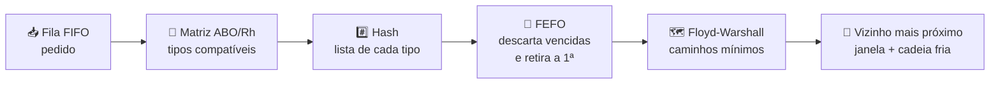

<div align="center">

# 🩸 Rota Vital

### Gestão e distribuição de hemocomponentes na rede de sangue
**Projeto Integrador · Unidade 2** — CESAR School


📄 **Documentação completa (PDF):** [`docs/Rota_Vital_U2.pdf`](docs/Rota_Vital_U2.pdf)

</div>

---

## 📑 Sumário

- [👥 Equipe](#-equipe)
- [🎯 O problema](#-o-problema)
- [🧠 Os quatro algoritmos](#-os-quatro-algoritmos)
- [🔀 Fluxo integrado](#-fluxo-integrado)
- [🔁 Tradução comentada C/C++ → Java](#-tradução-comentada-cc--java)
- [⏱️ Complexidade](#️-complexidade)
- [✅ Testes](#-testes)
- [📋 Critérios e regra geral](#-critérios-e-regra-geral)
- [▶️ Como executar](#️-como-executar)
- [🗂️ Estrutura](#️-estrutura)
- [⚠️ Limites e cuidados](#️-limites-e-cuidados)

---

## 👥 Equipe

<table>
<tr>
<td align="center"><br><b>Ewerton Guilherme da Silva</b><br><sub>Product Owner</sub></td>
<td align="center"><<br><b>Pablo Arthur Eustáquio de Lima</b><br><sub>Backend Developer</sub></td>
<td align="center"><br><b>João Ricardo Alves de Brito</b><br><sub>Backend Developer</sub></td>
<td align="center"><br><b>Lucas Aprigio dos Santos</b><br><sub>Backend Developer</sub></td>
</tr>
<tr>
<td align="center"><br><b>Saulo Eduardo Almeida dos Santos</b><br><sub>Backend Developer</sub></td>
<td align="center"><br><b>Thiago Cardozo da Conceição</b><br><sub>Frontend / UI Designer</sub></td>
<td align="center"><br><b>Eloi de Lima Sousa</b><br><sub>Frontend / UI Designer</sub></td>
<td></td>
</tr>
</table>

---

## 🎯 O problema

A rede de sangue precisa garantir **o componente certo** (compatível e dentro da validade), **no lugar certo**, **no tempo certo** e **na temperatura certa**. Falhas geram desabastecimento, descarte por vencimento e risco ao paciente.

| 🩸 Componente certo | ⏱️ Tempo certo | ❄️ Temperatura certa |
|---|---|---|
| Matriz ABO/Rh + descarte automático de vencidas | FEFO + verificação da janela de cada hospital | Limite simulado de 120 min de caixa térmica por parada |

---

## 🧠 Os quatro algoritmos

| | Algoritmo | Estrutura | Aula | Custo |
|---|---|---|---|---|
| 🧬 | **Compatibilidade ABO/Rh** | Matriz 8×8 `[doador][receptor]` (hemácias/plaquetas e plasma com regra invertida) | 06 / estruturas | `O(1)` |
| 📅 | **Priorização FEFO** | Lista encadeada com inserção ordenada por validade | 03 | `O(m)` inserir · `O(1)` retirar |
| #️⃣ | **Índice de estoque por hash** | Encadeamento por (componente, tipo) + sondagem linear por id | 06 | `O(1)` médio |
| 🗺️ | **Roteirização** | Floyd-Warshall + vizinho mais próximo | 04–05 | `O(V³ + k²)` |

**Apoio:** fila FIFO de pedidos (aula 03) · Bubble, Selection, Insertion, Shell, Quick e Merge Sort (aulas 07–08) · busca sequencial e binária iterativa e recursiva (aulas 02 e 06).

> 🔒 Nada de `HashMap`, `PriorityQueue`, `LinkedList` ou `Arrays.sort`: a função hash, as colisões, a inserção ordenada e as ordenações estão escritas à mão **nas duas linguagens**.

---

## 🔀 Fluxo integrado



**Regra de alocação:** primeiro o **tipo idêntico** (FEFO); se faltar, o **compatível que vence antes**, comparando só as cabeças das listas. Isso poupa o O− (doador universal) e reduz o descarte.

<details>
<summary>📊 <b>Resultado do cenário de demonstração</b></summary>

- 22 bolsas carregadas · **3 descartadas** por vencimento na varredura diária
- 6 pedidos → **5 atendidos**, 1 parcial (B−: 1 de 2)
- Rota de **126 min**: Alfa → Beta → Gama → Epsilon → Delta → volta
- ⚠️ **1 alerta**: Delta chega aos 81 min com janela de 75 — o vizinho mais próximo é guloso e não olha prazos; o sistema detecta e sinaliza.

</details>

---

## 🔁 Tradução comentada C/C++ → Java

> A disciplina avalia o **raciocínio**. Escrevemos primeiro em C/C++ e traduzimos para Java OO mantendo **o mesmo algoritmo, os mesmos nomes e a mesma saída** (`diff` entre as duas saídas só difere no cabeçalho).

**Como a tradução aparece no código**

1. 📌 **Bloco de cabeçalho** em cada classe Java mostrando a declaração C++ original e o que mudou.
2. 💬 **Comentário na linha** onde a forma mudou: `atual = atual.prox;  // C++: atual = atual->prox;`
3. 🧩 **Nomes paralelos:** `fefoInserir` → `ListaFefo.inserir`, `hashBuscar` → `HashEstoque.buscar`, `alocar` → `ServicoAlocacao.alocar`.

**As quatro regras que seguimos**

| Regra | C/C++ | Java | Por quê |
|---|---|---|---|
| 🏗️ Struct + funções → classe | `hashBuscar(HashEstoque* h, int chave)` | `hashEstoque.buscar(chave)` | O ponteiro `h` vira o `this` implícito |
| 🔗 Ponteiro → referência | `NoBolsa* prox` · `->` · `NULL` · `delete` | `No prox` · `.` · `null` · *(GC)* | Não existe `delete`; o coletor de lixo libera |
| ↩️ Parâmetro de saída → retorno | `bool dequeue(FilaPedidos* f, Pedido* saida)` | `Pedido dequeue()` | Java não tem ponteiro de saída |
| 🧱 Imutabilidade | `Bolsa b = outra;` **copia** | referência ao **mesmo** objeto | `Bolsa` é `final` para compartilhar sem efeito colateral |

<details>
<summary>📖 <b>Dicionário completo de tradução</b></summary>

| C/C++ | Java | Comentário |
|---|---|---|
| `struct Bolsa {...}` | `public final class Bolsa` | Dados + comportamento |
| `Bolsa novaBolsa(...)` | `new Bolsa(...)` | Fábrica vira construtor |
| `hashInicializar(&h)` | `new HashEstoque()` | Arrays Java já nascem `null`/0 |
| `head = fefoInserir(head, b)` | `lista.inserir(b)` | Cabeça vira atributo |
| `enum Tipo` + `const char* NOME[]` | `enum` com `toString()` | Índice via `ordinal()` |
| `const int M[8][8]` | `private static final int[][]` | Constante da classe |
| `Bolsa arr[], int n` | `Bolsa[] arr` | `arr.length` |
| `Bolsa bolsas[10]; int qtd;` | `List<Bolsa>` | Só recipiente do resultado |
| `std::swap(a, b)` | `swap(arr, i, j)` | Troca manual de referências |
| `new Bolsa[n]` … `delete[] aux` | `new Bolsa[n]` | Sem `delete[]` |
| `g_verboso`, `g_comparacoes` | atributos de `Estoque`, `Ordenacao` | Sem estado global |
| `const char* data(int)` (buffer `static`) | `String Datas.formatar(int)` | String nova com segurança |
| `printf("%4lld")` | `System.out.printf("%4d")` | Mesmo formato |
| `int main()` + funções soltas | objetos colaborando | No Spring Boot: `@Service` + `@RestController` |

</details>

📄 O PDF traz **o código C++ e Java lado a lado** para cada estrutura, extraído direto dos fontes.

---

## ⏱️ Complexidade

<sub>n = estoque · m = bolsas da chave · q = pedidas · v = vencidas · V = vértices · k = paradas</sub>

| Operação | Custo | Justificativa pela implementação |
|---|---|---|
| Compatibilidade ABO/Rh | `O(1)` | Um acesso `[doador][receptor]`, sem laço |
| Inserção FEFO | `O(m)` | `while` até a posição; O(1) se virar cabeça |
| Retirada FEFO | `O(1)` | Remove a cabeça |
| Descarte de vencidas | `O(v)` | Vencidas são **prefixo** da lista ordenada |
| Hash (encadeamento) | `O(1 + α)` | `chave % 7`; α ≤ 24/7 ≈ 3,4 (constante) |
| Hash (sondagem linear) | `O(1)` médio | Carga 22%; pior caso com agrupamento primário |
| Fila FIFO | `O(1)` | Ponteiros de início e fim |
| **Alocação de um pedido** | **`O(v + q)`** | 8 tipos fixos; **não depende de n** |
| Floyd-Warshall | `O(V³)` | 3 laços de V = 6 → 216 relaxamentos, uma vez |
| Vizinho mais próximo | `O(k²)` | k(k+1)/2 consultas à matriz `dist` |
| Bubble / Selection / Insertion | `O(n²)` | Bubble e Insertion: O(n) no melhor caso |
| Shell / Quick / Merge | `O(n²)` / `O(n²)` / `O(n log n)` | Quick e Shell O(n log n) no médio |
| Busca sequencial / binária | `O(n)` / `O(log n)` | Recursiva usa O(log n) de pilha |

<details>
<summary>📈 <b>Comparações reais das ordenações (n = 8)</b></summary>

| Método | Comparações |
|---|---|
| Merge Sort | 15 |
| Insertion Sort | 16 |
| Quick Sort | 18 |
| Shell Sort | 22 |
| Bubble Sort | 27 |
| Selection Sort | 28 |

O vetor exportado já vem em blocos ordenados (listas FEFO), por isso Insertion e Merge vencem e Selection não aproveita.

</details>

---

## ✅ Testes

**32 testes, iguais em C++ e Java, todos passando.**

| Grupo | Casos |
|---|---|
| 🧬 Compatibilidade de hemácias | O−→AB+ ✔ · O−→O− ✔ · A−→A+ ✔ · AB+→AB+ ✔ · O+→O− ✘ · A+→O+ ✘ · B−→A− ✘ · AB+→A+ ✘ · O− tem 1 doador · AB+ tem 8 |
| 🧪 Compatibilidade de plasma | AB+→O− ✔ · A−→O+ ✔ · O+→A+ ✘ · B+→AB− ✘ |
| 📅 FEFO | Ordem por validade com desempate por id |
| #️⃣ Hash e índice | Chave existente / inexistente · busca e remoção por id |
| 🔀 Alocação integrada | Tipo idêntico primeiro · compatível que vence antes · descarte de vencida · atendimento parcial · **nunca entrega incompatível** · plasma aceita AB · sem estoque → 0 |
| 📊 Ordenação e busca | 6 algoritmos dão a mesma ordem · binária iterativa = recursiva = sequencial |
| 🗺️ Grafo | Distâncias Floyd-Warshall · ordem do vizinho mais próximo |

---

## 📋 Critérios e regra geral

| Critério | Onde está |
|---|---|
| ✅ ABO/Rh via matriz com testes de compatibilidade e incompatibilidade | `compativel` / `MatrizCompatibilidade` · 18 testes |
| ✅ Integração rota + validade + compatibilidade + hash em Java | `RotaVitalApp` → `ServicoAlocacao` → `Roteirizador` |
| ✅ Complexidade correta e justificada | Tabela acima + PDF (seções 04–14) |
| ✅ Tradução comentada C/C++ ↔ Java | Cabeçalhos e `// C++:` em cada classe + PDF lado a lado |

> **Regra geral:** entrega só em Java, sem a versão C/C++ e sem a tradução comentada, não é aceita.
>
> ✔️ Versão C/C++ completa (`cpp/rota_vital.cpp`, sem avisos com `-Wall -Wextra`)
> ✔️ Versão Java correspondente (19 classes)
> ✔️ Tradução comentada no código e no PDF
> ✔️ Mesma lógica comprovada: mesmos 32 testes e saída idêntica

---

## ▶️ Como executar

**C/C++**
```bash
cd cpp
g++ -std=c++17 -Wall -Wextra -o rota_vital rota_vital.cpp
./rota_vital            # Windows: rota_vital.exe
```

**Java (JDK 11+)**
```bash
cd java
javac -encoding UTF-8 -d out src/rotavital/*.java     # Windows: src\rotavital\*.java
java -cp out rotavital.RotaVitalApp                   # cenário + testes
java -cp out rotavital.TestesRotaVital                # só os testes
```

> 💡 **VS Code:** abra a pasta `java` como raiz **ou** mantenha `rota_vital` aberta — o `.vscode/settings.json` incluído aponta `java/src` como código-fonte. Depois rode *Java: Clean Java Language Server Workspace*.

---

## 🗂️ Estrutura

```
rota_vital/
├── 📄 README.md
├── ⚙️ .vscode/settings.json
├── 📁 cpp/
│   ├── rota_vital.cpp              versão C/C++ completa
│   └── saida_cpp.txt               execução de referência
├── 📁 java/
│   ├── saida_java.txt
│   └── src/rotavital/
│       ├── MatrizCompatibilidade   🧬 ABO/Rh
│       ├── ListaFefo               📅 FEFO
│       ├── HashEstoque · IndicePorId · Estoque   #️⃣ hash
│       ├── Grafo · Roteirizador    🗺️ rota
│       ├── FilaPedidos · ServicoAlocacao · Alocacao · Pedido
│       ├── Ordenacao · Busca
│       ├── Bolsa · TipoSanguineo · Componente · Datas
│       ├── TestesRotaVital         ✅ 32 testes
│       └── RotaVitalApp            ▶️ main
└── 📁 docs/
    ├── Rota_Vital_U2.pdf           documentação detalhada
    ├── build_pdf.py                gera o PDF a partir do código
    └── equipe/                     fotos da equipe
```

---

## ⚠️ Limites e cuidados

- 🔒 **Apenas dados sintéticos** — nenhuma informação real de doadores ou pacientes (LGPD)
- 🩺 **Matriz ABO/Rh didática** — não substitui protocolo clínico
- 🌡️ **Telemetria simulada** — cadeia fria é um limite fixo de 120 min
- 🕸️ **Grafo limitado** — 6 vértices e 9 arestas
- 🚫 **Sem integração** com sistemas oficiais da Hemorrede
